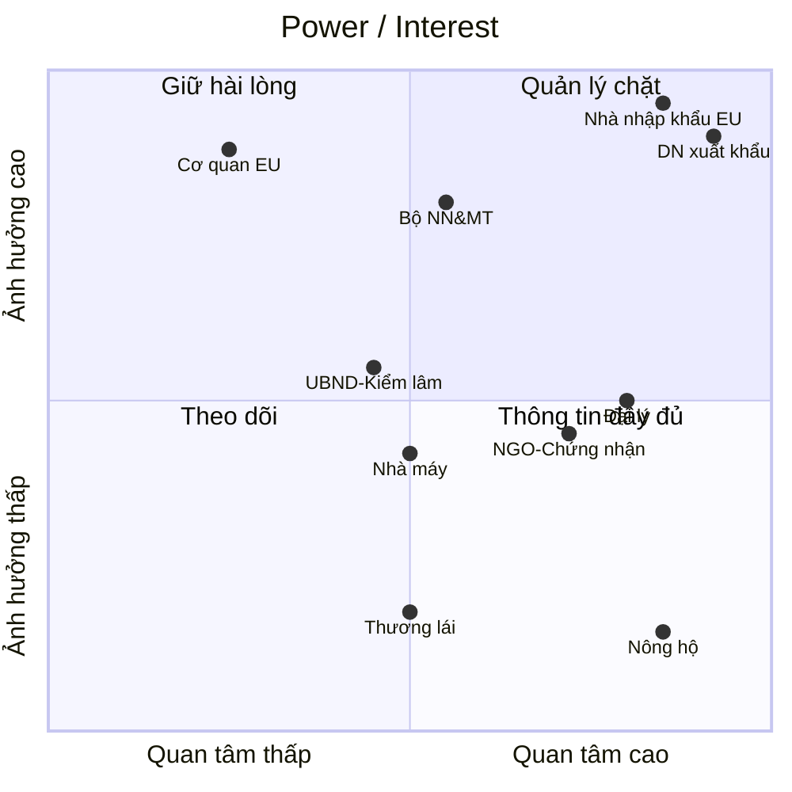

# S3 — Phân tích stakeholder

## 1. Danh sách và đặc điểm

| Mã | Bên liên quan | Vai trò trong chuỗi | Quan tâm | Lo ngại | Dữ liệu đang có | Power | Interest | Căn cứ |
|---|---|---|---|---|---|:-:|:-:|---|
| SH-01 | Nông hộ | Trồng, bán cà phê tươi/nhân | Giá bán, bán được hàng | Bị loại khỏi chuỗi; lộ thông tin đất | Giấy chứng nhận QSDĐ (một phần); ít ghi chép | L | H | SRC-027 |
| SH-02 | Thương lái | Gom hàng từ nhiều hộ | Giữ khối lượng, biên lợi nhuận | Bị cắt khỏi chuỗi; tốn thời gian ghi nguồn | Sổ tay, ghi chép rời | L | M | ROADMAP 1.3 [Inference] |
| SH-03 | Đại lý | Thu mua, sơ chế, bán cho DN | Hợp đồng ổn định với DN | Chi phí thu tọa độ; trách nhiệm dữ liệu | Sổ/Excel giao dịch | M | H | ASM-06 |
| SH-04 | Nhà máy chế biến | Xát, phân loại, đóng bao | Công suất, chất lượng | Tách dòng làm giảm hiệu suất | Phiếu nhập kho theo đại lý | M | M | [Inference] |
| SH-05 | DN xuất khẩu (khách hàng giả định) | Ký hợp đồng EU, xuất hàng | Giữ thị trường EU, chi phí tuân thủ thấp | Mất khách EU; đầu tư không thu hồi | ERP, hợp đồng, chứng từ XK | H | H | DEC-02 |
| SH-06 | Nhà nhập khẩu/rang xay EU (operator) | Nộp DDS, chịu trách nhiệm pháp lý | Dữ liệu đầy đủ, đúng hạn | Phạt ≥ 4% doanh thu; hàng bị giữ | Hệ thống thẩm định riêng | H | H | SRC-003 Điều 25 |
| SH-07 | Cơ quan có thẩm quyền EU | Kiểm tra operator/hàng | Tuân thủ | Gian lận, trộn hàng | Hệ thống thông tin Điều 33 | H | L | SRC-001 Điều 14–16 |
| SH-08 | Bộ NN&MT | Chính sách, cơ sở dữ liệu quốc gia | Giữ xếp hạng rủi ro thấp | Phá rừng mới làm đổi xếp hạng | Bản đồ rừng, CSDL vùng trồng thí điểm | H | M | SRC-007, SRC-028 |
| SH-09 | UBND xã / kiểm lâm | Xác nhận đất, quản lý rừng | Quản lý đất đai, rừng | Tranh chấp ranh giới | Hồ sơ địa chính, bản đồ rừng địa phương | M | M | [Inference] |
| SH-10 | Tổ chức chứng nhận / NGO (4C, RA, IDH) | Chứng nhận, hỗ trợ kỹ thuật | Chuỗi bền vững | Trùng lặp dữ liệu | Dữ liệu nông hộ đã chứng nhận | M | H | SRC-023, SRC-029 |

## 2. Ma trận Power/Interest

| Ô | Bên | Chiến lược |
|---|---|---|
| Quản lý chặt | DN xuất khẩu, nhà nhập khẩu EU, Bộ NN&MT | Đồng thiết kế yêu cầu; duyệt SRS; thống nhất định dạng gói DDS với nhà nhập khẩu |
| Giữ hài lòng | Cơ quan có thẩm quyền EU | Bám nguyên văn luật; hồ sơ sẵn sàng khi bị kiểm tra (lưu 5 năm) |
| Thông tin đầy đủ | Nông hộ, đại lý, NGO/chứng nhận | Truyền thông lợi ích; đào tạo đại lý; tái sử dụng dữ liệu chứng nhận |
| Theo dõi | Thương lái, nhà máy, UBND/kiểm lâm | Vai trò "điểm thu mua đã đăng ký"; quy trình tách dòng tối thiểu; kênh xác nhận đất |
