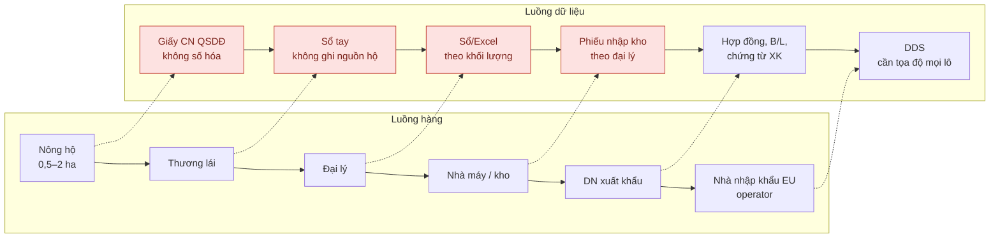

# S5 — Chuỗi giá trị As-Is (luồng hàng + luồng dữ liệu)

Nguồn sơ đồ: Mermaid (GitHub tự vẽ). Ô đỏ là điểm dữ liệu bị đứt.

## Điểm đứt dữ liệu

| Mã | Điểm đứt | Vị trí | Hệ quả EUDR | Căn cứ |
|---|---|---|---|---|
| GAP-01 | Không có tọa độ/đa giác lô | Nông hộ | Không đáp ứng Điều 2(28), 9(1)(d) | SRC-027 (~1/10 có dữ liệu lô) |
| GAP-02 | Thương lái gom nhiều hộ, không ghi nguồn | Thương lái | Mất liên kết lô ↔ khối lượng | ROADMAP 1.3 [Inference] |
| GAP-03 | Trộn hàng nhiều nguồn tại kho | Đại lý, nhà máy | Không liệt kê được "mọi lô"; mất điều kiện Điều 13(1) | Điều 10(2)(j) |
| GAP-04 | Không kiểm tra lô với bản đồ rừng 2020 / mất cây che phủ sau 2020 | DN | Không có bằng chứng Điều 9(1)(g) | SRC-011 |
| GAP-05 | Giấy tờ đất không số hóa/thiếu | Nông hộ, DN | Không chứng minh hợp pháp Điều 9(1)(h) | SRC-027 |
| GAP-06 | Không có kênh dữ liệu sang operator, không lưu hồ sơ 5 năm | DN ↔ nhà nhập khẩu | DDS không lập được; hàng bị giữ tại hải quan (Điều 26(4)) | DEC-03 |
| GAP-07 | Thiếu thông tin định danh nhà cung cấp (tên, địa chỉ, email) | Thương lái, đại lý | Không đáp ứng Điều 9(1)(e) | [Inference] |
