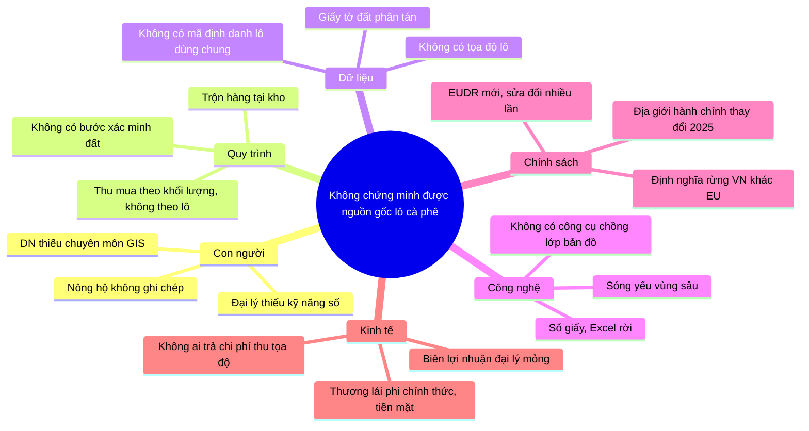

# S6 — Phân tích nguyên nhân gốc

**Câu hỏi gốc:** Vì sao DN xuất khẩu không chứng minh được nguồn gốc lô cà phê?

## 1. Fishbone (6 nhánh)

## 2. 5 Whys — hai nhánh nặng nhất

**Nhánh Dữ liệu**

1. Vì sao không có tọa độ lô trong hồ sơ lô hàng? → Hàng đến DN không kèm danh sách lô.
2. Vì sao? → Đại lý ghi giao dịch theo khối lượng và tên người bán, không theo lô.
3. Vì sao? → Không có mã định danh lô dùng chung giữa nông hộ, đại lý và DN.
4. Vì sao? → Chưa ai đăng ký lô; dữ liệu địa chính không liên thông với chuỗi thu mua.
5. Vì sao? → Trước EUDR, không có yêu cầu thị trường nào đòi dữ liệu cấp lô cho hàng đại trà. → **RC-02, RC-05**

**Nhánh Quy trình**

1. Vì sao không tách được hàng theo lô? → Hàng nhiều hộ bị trộn ở thương lái và kho đại lý.
2. Vì sao? → Thu mua tối ưu cho khối lượng và chi phí vận chuyển.
3. Vì sao? → Biên lợi nhuận mỏng, tách dòng tốn kho và công.
4. Vì sao? → Không có giá thưởng cho hàng truy xuất được.
5. Vì sao? → Thương lái phi chính thức, giao dịch tiền mặt, không có động lực ghi nguồn. → **RC-01, RC-04**

## 3. Nguyên nhân gốc

| Mã | Nguyên nhân gốc | Nhánh | Căn cứ | GAP liên quan |
|---|---|---|---|---|
| RC-01 | Chuỗi thu mua phi chính thức, tiền mặt; không có động lực ghi nguồn | Kinh tế | ROADMAP 1.3 [Inference] | GAP-02, GAP-07 |
| RC-02 | Không có mã định danh lô/nông hộ dùng chung trong chuỗi | Dữ liệu | SRC-027 | GAP-01, GAP-06 |
| RC-03 | Năng lực và chi phí số hóa của nông hộ/đại lý thấp | Con người, Kinh tế | SRC-027 | GAP-01 |
| RC-04 | Quy trình kho tối ưu cho khối lượng (trộn), không cho tách dòng | Quy trình | Điều 10(2)(j) | GAP-03 |
| RC-05 | Dữ liệu đất đai phân tán, không liên thông; một phần hộ thiếu giấy tờ | Dữ liệu, Chính sách | SRC-027 | GAP-05 |
| RC-06 | DN thiếu năng lực phân tích không gian để tự tạo bằng chứng không phá rừng | Công nghệ | SRC-011; S10 | GAP-04 |
