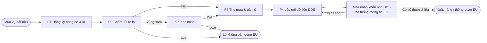

# S11 — Quy trình To-Be (BPMN)

> Dạng chữ chuẩn BPMN để vẽ lại trên draw.io / Camunda Modeler (`.bpmn` + `.png` lưu cùng thư mục). Sơ đồ Mermaid dưới đây dùng để xem nhanh.
> Pool: Nông hộ · Đại lý · DN xuất khẩu (Thu mua, Tuân thủ) · Hệ thống ECTS · Nhà nhập khẩu EU (operator) · Hệ thống thông tin EU.

## Cấp 1 — Toàn chuỗi

| Bước | Xử lý GAP / RC |
|---|---|
| P1 Đăng ký nông hộ & lô | GAP-01, GAP-05, GAP-07 · RC-02, RC-03, RC-05 |
| P2 Chấm rủi ro + P2b Xác minh | GAP-04 · RC-06 |
| P3 Thu mua & gắn lô (tách dòng EU) | GAP-02, GAP-03 · RC-01, RC-04 |
| P4 Gói dữ liệu DDS + lưu hồ sơ | GAP-06 · RC-02 |

Mọi GAP ở S5 (GAP-01…07) đều được xử lý ở ít nhất một bước.

## Cấp 2 — P1 Đăng ký nông hộ & lô đất

| # | Pool / Lane | Phần tử BPMN | Mô tả | BR |
|---|---|---|---|---|
| 1 | Đại lý | Start event | Nông hộ đồng ý tham gia | — |
| 2 | Đại lý | User task | Ghi thông tin nông hộ + đồng ý xử lý dữ liệu cá nhân | BR-006 |
| 3 | Đại lý | Exclusive gateway | Diện tích lô > 4 ha? | BR-002 |
| 4a | Đại lý | User task | ≤ 4 ha: lấy điểm GPS tại lô | BR-001 |
| 4b | Đại lý | User task | > 4 ha: đi quanh ranh hoặc vẽ đa giác | BR-002, BR-003 |
| 5 | ECTS | Service task | Kiểm tra hình học, chồng lấn, lệch diện tích | BR-003, BR-004, BR-005 |
| 6 | Đại lý | User task | Chụp/nhập giấy tờ đất (số GCN QSDĐ) | BR-020 |
| 7 | ECTS | Service task | Đánh giá pháp lý: Đủ / Thiếu / Mâu thuẫn | BR-020, BR-021 |
| 8 | ECTS | Intermediate event | Lô chuyển "Chờ chấm" → kích hoạt P2 | — |
| E1 | ECTS | Error boundary | Hình học sai → trả về bước 4 | BR-003 |
| E2 | Đại lý | Timer boundary | Offline → lưu nháp trên máy, đồng bộ khi có mạng | NFR-001 |

## Cấp 2 — P2 Chấm rủi ro → P2b Xác minh

| # | Pool / Lane | Phần tử BPMN | Mô tả | BR |
|---|---|---|---|---|
| 1 | ECTS | Service task | Chồng lô với rừng 2020 (JRC GFC2020) và mất cây che phủ sau 2020 (Hansen) + vùng đệm | BR-010…014 |
| 2 | ECTS | Business rule task | Bảng quyết định → Đạt / Vùng xám / Loại | BR-010…014 |
| 3 | Tuân thủ | User task | Vùng xám: đối chiếu ảnh lịch sử 2019–2021 | BR-016 |
| 4 | Tuân thủ | Exclusive gateway | Kết luận được tại bàn? | — |
| 5 | Đại lý | User task | Khảo sát thực địa, ảnh gắn tọa độ | BR-016 |
| 6 | Tuân thủ | User task | Quyết định Đạt / Loại + lý do | BR-016 |
| T1 | ECTS | Timer boundary | Vùng xám > 14 ngày → cảnh báo | BR-015 |
| S1 | ECTS | Signal start | Bản đồ có phiên bản mới / mất cây che phủ mới → chấm lại | BR-017, BR-018 |

## Cấp 2 — P3 Thu mua & gắn lô → P4 Gói dữ liệu DDS

| # | Pool / Lane | Phần tử BPMN | Mô tả | BR |
|---|---|---|---|---|
| 1 | Đại lý | User task | Ghi giao dịch: nông hộ, lô, khối lượng, ngày | BR-030, BR-031 |
| 2 | Đại lý | Manual task | Giữ hàng dòng EU tách riêng (bao/kho riêng) | BR-033 |
| 3 | Thu mua | User task | Nhập kho DN từ đại lý, kế thừa danh sách lô | BR-032 |
| 4 | Thu mua | User task | Lập lô hàng xuất EU, phân bổ phiếu nhập | BR-032, BR-033 |
| 5 | Tuân thủ | User task | Lập gói dữ liệu DDS | BR-040, BR-041 |
| 6 | ECTS | Service task | Kiểm tra: mọi lô Đạt + pháp lý Đủ; sinh GeoJSON | BR-040, BR-041 |
| 7 | Tuân thủ | Send task | Gửi gói cho nhà nhập khẩu | — |
| 8 | Nhà nhập khẩu | User task | Nộp DDS lên hệ thống thông tin EU (ngoài ECTS) | REQ-EU-010 |
| 9 | Tuân thủ | Receive task | Nhận số tham chiếu / kết quả | BR-042 |
| E1 | Tuân thủ | Error event | DDS bị từ chối → lô hàng về Nháp | BR-042 |
| T1 | ECTS | Timer | Tàu đến < 5 ngày, chưa có số tham chiếu → cảnh báo | BR-043 |
| 10 | ECTS | Service task | Lưu hồ sơ ≥ 5 năm | BR-050 |
