# S12 — BFD & Function list

## BFD

```mermaid
flowchart TB
  ECTS[ECTS] --> G1[1. Đăng ký nông hộ & lô đất] & G2[2. Chấm rủi ro lô] & G3[3. Ghi nhận thu mua] & G4[4. Gói dữ liệu DDS] & G5[5. Dashboard, audit, quản trị]
  G1 --> F01[FR-001 Đăng ký nông hộ] & F02[FR-002 Lô bằng điểm] & F03[FR-003 Lô bằng đa giác] & F04[FR-004 Kiểm tra hình học] & F05[FR-005 Giấy tờ đất] & F06[FR-006 Offline & đồng bộ] & F07[FR-007 Nhập lô hàng loạt]
  G2 --> F08[FR-008 Chấm tự động] & F09[FR-009 Chấm lại theo phiên bản] & F10[FR-010 Xác minh Vùng xám] & F11[FR-011 Đánh giá pháp lý] & F12[FR-012 Cảnh báo mất che phủ mới]
  G3 --> F13[FR-013 Giao dịch thu mua] & F14[FR-014 Nhập kho DN] & F15[FR-015 Lô hàng xuất] & F16[FR-016 Đại lý & nhà cung cấp]
  G4 --> F17[FR-017 Lập gói DDS] & F18[FR-018 Xuất & gửi gói] & F19[FR-019 Số tham chiếu & từ chối] & F20[FR-020 Hồ sơ 5 năm]
  G5 --> F21[FR-021 Dashboard & KPI] & F22[FR-022 Audit log] & F23[FR-023 Người dùng & phân quyền] & F24[FR-024 Tham số hệ thống]
```

## Function list

Bản dữ liệu chuẩn: [../trace/fr.csv](../trace/fr.csv). Bảng dưới là bản xem nhanh.

| id | group | function | actor | related_req_eu | related_rc |
|---|---|---|---|---|---|
| FR-001 | 1 | Đăng ký nông hộ | Đại lý | REQ-EU-021 | RC-02 |
| FR-002 | 1 | Đăng ký lô bằng điểm GPS (≤ 4 ha) | Đại lý | REQ-EU-007, 020, 038 | RC-02, RC-03 |
| FR-003 | 1 | Đăng ký lô bằng đa giác (bắt buộc > 4 ha) | Đại lý | REQ-EU-007, 020, 038 | RC-02, RC-03 |
| FR-004 | 1 | Kiểm tra hình học, chồng lấn, lệch diện tích | Hệ thống | REQ-EU-007, 008 | RC-02 |
| FR-005 | 1 | Đính kèm giấy tờ đất | Đại lý | REQ-EU-002, 024, 025 | RC-05 |
| FR-006 | 1 | Làm việc offline và đồng bộ | Đại lý | REQ-EU-007 | RC-03 |
| FR-007 | 1 | Nhập lô hàng loạt (GeoJSON/CSV) | Tuân thủ | REQ-EU-020 | RC-02, RC-03 |
| FR-008 | 2 | Chấm rủi ro lô tự động | Hệ thống | REQ-EU-001, 004, 005, 006, 023, 035 | RC-06 |
| FR-009 | 2 | Chấm lại theo phiên bản bản đồ | Hệ thống | REQ-EU-029, 034 | RC-06 |
| FR-010 | 2 | Xác minh Vùng xám | Tuân thủ, Đại lý | REQ-EU-030, 012 | RC-06 |
| FR-011 | 2 | Đánh giá pháp lý lô | Tuân thủ | REQ-EU-002, 008, 024, 025 | RC-05 |
| FR-012 | 2 | Cảnh báo mất cây che phủ mới | Hệ thống | REQ-EU-034 | RC-06 |
| FR-013 | 3 | Ghi nhận giao dịch thu mua | Đại lý | REQ-EU-012, 020, 027 | RC-01, RC-04 |
| FR-014 | 3 | Nhập kho DN từ đại lý | Thu mua | REQ-EU-018, 027 | RC-04 |
| FR-015 | 3 | Lập lô hàng xuất, cân đối khối lượng | Thu mua | REQ-EU-018, 028, 033 | RC-04 |
| FR-016 | 3 | Quản lý đại lý & thông tin nhà cung cấp | Thu mua | REQ-EU-021 | RC-01 |
| FR-017 | 4 | Lập gói dữ liệu DDS | Tuân thủ | REQ-EU-003, 009, 010, 017, 019, 020, 023, 024, 037, 038 | RC-02 |
| FR-018 | 4 | Xuất & gửi gói cho nhà nhập khẩu | Tuân thủ | REQ-EU-015, 016, 022 | RC-02 |
| FR-019 | 4 | Ghi số tham chiếu DDS, xử lý từ chối | Tuân thủ | REQ-EU-011, 013, 036 | RC-02 |
| FR-020 | 4 | Lưu & truy vấn hồ sơ 5 năm | Tuân thủ | REQ-EU-017, 031, 032 | RC-02 |
| FR-021 | 5 | Dashboard rủi ro & KPI | Quản lý | REQ-EU-035 | RC-06 |
| FR-022 | 5 | Nhật ký audit | Quản trị | REQ-EU-029, 032 | RC-02 |
| FR-023 | 5 | Người dùng & phân quyền | Quản trị | — (NFR bảo mật) | — |
| FR-024 | 5 | Tham số hệ thống (ngày áp dụng, vùng đệm, phiên bản bản đồ) | Quản lý | REQ-EU-040, 026 | — |
