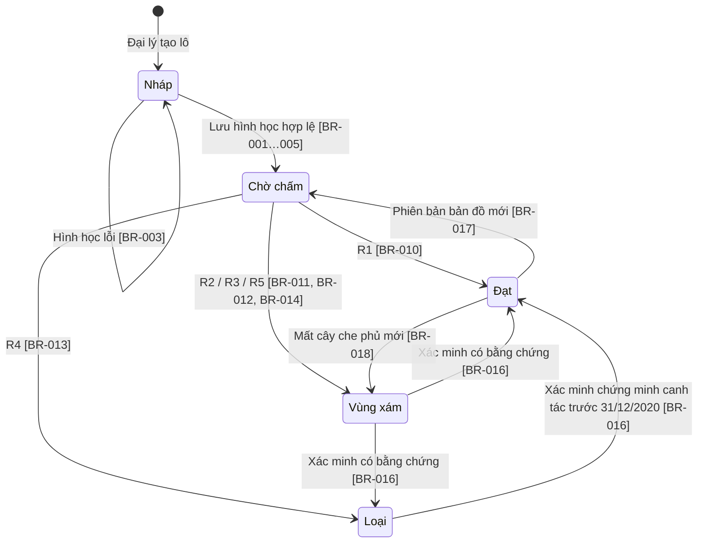
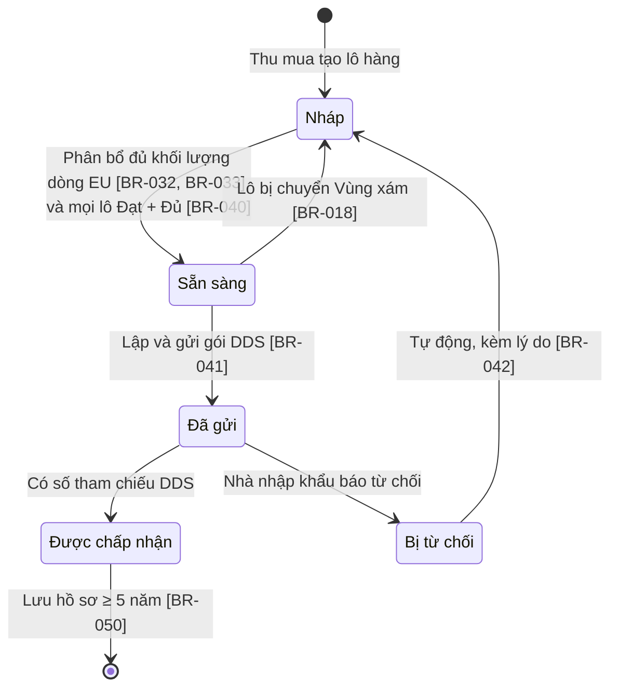

# S15 — State machine

## Lô đất (kết quả chấm)

Trạng thái pháp lý chạy song song: **Thiếu → Đủ** (bổ sung giấy tờ, BR-020) · **Đủ ↔ Mâu thuẫn** (lệch diện tích > 20%, BR-021). Lô chỉ vào dòng EU khi **Đạt + Đủ** (BR-030, BR-040).

## Lô hàng / gói DDS

Cảnh báo theo thời gian: lô Vùng xám > 14 ngày (BR-015); lô hàng Đã gửi, còn < 5 ngày tới ngày tàu, chưa có số tham chiếu (BR-043).
