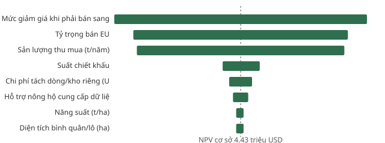

# S18 — Business case: ECTS cho DakCoffee Export

> Trả lời **RQ5**: nên đầu tư theo phương án nào, và khi nào **không** đáng đầu tư.
> Mô hình: [S18_model.py](S18_model.py) → [model_results.json](model_results.json). Các bảng có mốc `GEN` do mô hình sinh. Mọi tham số có min/likely/max và mã ASM ([assumptions-log](../00-management/assumptions-log.csv)).

## 1. Ba phương án (T16.1)

| | A. Tự xây | B. Thuê nền tảng SaaS | C. Liên minh ngành |
|---|---|---|---|
| Mô tả | DN thuê đơn vị phát triển ECTS theo SRS | DN thuê nền tảng truy xuất có sẵn, cấu hình theo SRS | Nhiều DN dùng chung một nền tảng, chia chi phí và dữ liệu lô (nông hộ bán cho nhiều DN) |
| Điều kiện áp dụng | Có đội IT; quy trình đặc thù | Cần chạy nhanh trước 30/12/2026 | Có hiệp hội/đơn vị điều phối; thống nhất chuẩn dữ liệu |
| Ưu điểm | Toàn quyền dữ liệu, tùy biến | Nhanh (≈ 3 tháng), đầu tư thấp | Chi phí thấp nhất/lô; tránh thu tọa độ trùng; tốt cho nông hộ |
| Nhược điểm | Chậm (≈ 9 tháng), rủi ro dự án IT | Phụ thuộc nhà cung cấp; khó tùy biến BR; phí thuê lâu dài | Điều phối khó; quản trị dữ liệu chung; chậm khởi động |

## 2. Mô hình chi phí và lợi ích (T16.2–T16.3)

**Lợi ích/năm** = sản lượng EU × giá đơn vị EU × mức giảm giá tránh được.
- Sản lượng EU: 30.000 t × 45% = 13.500 t (ASM-01, ASM-02).
- Giá đơn vị EU 2023: **2.870 USD/t** (SRC-013: 1,41 tỷ USD / 490.382 t).
- Mức giảm giá tránh được: 6% (ASM-25). Nếu không đáp ứng EUDR, DN phải bán lượng hàng này sang thị trường khác với giá thấp hơn.

**Chi phí**

| Khoản | Năm 0 (đầu tư) | Năm 1–3 (vận hành) | Mã |
|---|---|---|---|
| Phần mềm | A: 150.000 USD · B: 5.000 khởi tạo · C: 30% của A | A: 20%/năm · B: 40.000/năm · C: 20% phần góp + 3.000 | ASM-18, 19, 20 |
| Thu tọa độ | 11.538 lô × 150.000 VND | Cập nhật 10%/năm | ASM-16; ASM-01/03/04 |
| Xác minh Vùng xám | 10% lô × 700.000 VND | 50%/năm | ASM-14, 17 |
| Đào tạo đại lý | 60 × 100 USD | 30%/năm | ASM-05, 28 |
| Nhân sự tuân thủ | — | 12.000 USD/năm | ASM-27 |
| Tách dòng hàng EU | — | 15 USD/t EU | ASM-31 |
| Hỗ trợ nông hộ | — | 10 USD/t EU | ASM-32 |

Kỳ tính: năm 0–3, chiết khấu 10% (ASM-30). Lợi ích năm 1 theo tốc độ triển khai: A 50% · B 90% · C 70% (ASM-29).

## 3. Kết quả, kịch bản, điểm hòa vốn (T16.3)

<!-- GEN:RESULTS:START -->
| Chỉ số (USD) | A. Tự xây ECTS | B. Thuê nền tảng SaaS | C. Liên minh ngành |
|---|---|---|---|
| NPV 3 năm — min / likely / max (triệu) | 0,57 / **3,46** / 11,14 | 0,79 / **4,43** / 14,36 | 0,73 / **4,04** / 12,86 |
| Lợi ích năm 2 (triệu) | 2,32 | 2,32 | 2,32 |
| Tổng chi phí năm 0–3 (triệu) | 1,47 | 1,35 | 1,31 |
| Chi phí/lô/3 năm | 127 | 117 | 113 |
| Hoàn vốn (năm) | 0,3 | 0,1 | 0,1 |
| Xác suất NPV > 0 (Monte Carlo 10.000 lần) | 100% | 100% | 100% |
| NPV P10 / P50 / P90 (triệu) | 1,69 / 3,39 / 5,90 | 2,36 / 4,41 / 7,42 | 2,14 / 4,00 / 6,77 |
| Kịch bản EUDR hoãn thêm 1 năm — NPV (triệu) | 2,41 | 2,53 | 2,56 |
| Kịch bản VN thành rủi ro chuẩn (Vùng xám ×2,5) — NPV (triệu) | 3,36 | 4,32 | 3,93 |
| Hòa vốn: tỷ trọng EU tối thiểu | 4,9% | 2,9% | 2,8% |
| Hòa vốn: sản lượng tối thiểu (t/năm) | 2.132 | 950 | 832 |
| Hòa vốn: mức giảm giá tối thiểu tránh được | 1,60% | 1,23% | 1,30% |
<!-- GEN:RESULTS:END -->

## 4. Phân tích độ nhạy (T16.4) — phương án B

<!-- GEN:TORNADO:START -->
| Tham số (±20%) | NPV khi −20% (triệu) | NPV khi +20% (triệu) | Biên độ |
|---|---:|---:|---:|
| Mức giảm giá khi phải bán sang thị trường khác (ASM-25) | 3,32 | 5,54 | 2,23 |
| Tỷ trọng bán EU (ASM-02) | 3,48 | 5,38 | 1,89 |
| Sản lượng thu mua (t/năm) (ASM-01) | 3,51 | 5,34 | 1,83 |
| Suất chiết khấu (ASM-30) | 4,60 | 4,27 | 0,33 |
| Chi phí tách dòng/kho riêng (USD/t EU) (ASM-31) | 4,53 | 4,33 | 0,20 |
| Hỗ trợ nông hộ cung cấp dữ liệu (USD/t EU) (ASM-32) | 4,50 | 4,36 | 0,13 |
<!-- GEN:TORNADO:END -->

**Ba tham số ảnh hưởng mạnh nhất:** mức giảm giá tránh được (ASM-25), tỷ trọng bán EU (ASM-02), sản lượng (ASM-01). Cả ba đều thuộc **phía lợi ích**; chi phí hệ thống và thu tọa độ chỉ ảnh hưởng nhỏ. Hệ quả: việc cần xác minh trước khi ra quyết định là **mức chênh giá thị trường** (ASM-25, tin cậy thấp), không phải báo giá phần mềm.

## 5. Ma trận quyết định có trọng số (T17.1)

<!-- GEN:MCDA:START -->
| Tiêu chí | Trọng số DN | Trọng số nông hộ | A | B | C |
|---|:-:|:-:|:-:|:-:|:-:|
| Chi phí 3 năm | 30% | 20% | 2 | 4 | 5 |
| Tốc độ triển khai | 25% | 15% | 2 | 5 | 3 |
| Độ tin cậy dữ liệu | 20% | 20% | 5 | 3 | 4 |
| Khả năng mở rộng | 10% | 10% | 4 | 3 | 5 |
| Tác động tới nông hộ | 15% | 35% | 3 | 2 | 5 |
| **Điểm có trọng số — góc nhìn DN** | | | **2.95** | **3.65** | **4.30** |
| **Điểm có trọng số — góc nhìn nông hộ** | | | **3.15** | **3.15** | **4.50** |
<!-- GEN:MCDA:END -->

Đổi trọng số từ góc nhìn DN sang góc nhìn nông hộ: **C giữ hạng nhất**. A và B hòa nhau ở góc nhìn nông hộ.

## 6. Khi nào KHÔNG đáng làm (T17.2)

Từ bảng điểm hòa vốn (mục 3), với các tham số khác ở mức likely:

| Điều kiện | Ngưỡng không đáng đầu tư |
|---|---|
| Mức giảm giá tránh được khi bán sang thị trường khác | **< khoảng 1,2–1,6%** giá (≈ 35–45 USD/t) |
| Tỷ trọng sản lượng bán sang EU | **< khoảng 3–5%** |
| Quy mô thu mua | **< khoảng 800–2.100 t/năm** |

**Phương án thay thế khi dưới ngưỡng:**
1. Chuyển phần hàng EU sang thị trường không áp dụng EUDR.
2. Tham gia liên minh ngành (C) với vai trò thành viên nhỏ, không tự đầu tư.
3. Bán qua DN lớn hơn đã có hệ thống truy xuất.

**Giới hạn của mô hình:**
- Lợi ích chỉ tính phần chênh giá tránh được. Chưa tính rủi ro mất hẳn khách hàng EU (nhà nhập khẩu chịu phạt tối đa ≥ 4% doanh thu nên có thể cắt nhà cung cấp) và chưa tính giá thưởng cho hàng truy xuất được.
- Xác suất NPV > 0 bằng 100% trong Monte Carlo phản ánh **khoảng giả định đang đặt**, không phải sự chắc chắn. Nếu ASM-25 thực tế < 1,5% thì kết luận đổi.

## 7. KPI theo SMART (T17.3)

| KPI | Định nghĩa | Công thức | Nguồn dữ liệu | Mục tiêu | Tần suất |
|---|---|---|---|---|---|
| KPI-1 Tọa độ hợp lệ | % lô có hình học đạt BR-001…003 | lô hợp lệ / lô đang cung ứng | ECTS FR-004 | ≥ 90% sau 6 tháng từ MVP | Tuần |
| KPI-2 Vùng xám đúng hạn | % lô Vùng xám được quyết định ≤ 14 ngày | lô quyết định ≤ 14 ngày / lô vào Vùng xám | ECTS FR-010 | ≥ 95% | Tuần |
| KPI-3 Gói DDS đúng hạn | % lô hàng EU có số tham chiếu trước ngày tàu đến | lô hàng có số tham chiếu trước ETA / lô hàng EU | ECTS FR-019 | 100% | Lô hàng |
| KPI-4 DDS bị từ chối | % gói bị nhà nhập khẩu từ chối | gói bị từ chối / gói đã gửi | ECTS FR-019 | ≤ 2% | Tháng |
| KPI-5 Sản lượng đủ điều kiện | % sản lượng thu mua đủ điều kiện dòng EU | kg từ lô Đạt + Đủ / kg thu mua | ECTS FR-013 | ≥ 60% sau mùa vụ 2026/27 | Tháng |
| KPI-6 Giữ nông hộ | % nông hộ năm trước tiếp tục bán | hộ bán năm nay ∩ năm trước / hộ năm trước | ECTS FR-001, FR-013 | ≥ 90% | Mùa vụ |

## 8. Khuyến nghị (T17.4)

**Chọn B (SaaS) cho MVP và R2, chuẩn bị chuyển sang C (liên minh ngành) ở R3.**

| Lý do | Căn cứ |
|---|---|
| Chỉ còn khoảng 2 tháng tới ngày áp dụng 30/12/2026. B là phương án duy nhất triển khai kịp mùa vụ 2026/27. | Điều 38(2); ASM-29 |
| B có NPV likely cao nhất; C cao nhất ở ma trận đa tiêu chí và theo góc nhìn nông hộ. | Mục 3, 5 |
| C cần đơn vị điều phối và chuẩn dữ liệu chung, nên không kịp cho năm đầu. | Mục 1 |

**Điều kiện kèm theo khi chọn B:**
1. Hợp đồng SaaS phải có điều khoản **xuất toàn bộ dữ liệu** (GeoJSON/CSV) để chuyển sang C.
2. Nền tảng phải cấu hình được bảng quyết định R1–R6 và các tham số SCR-07.
3. Lưu trữ ≥ 5 năm.

**Lộ trình 3 giai đoạn** (khớp release plan):

| Giai đoạn | Thời gian | Nội dung | Mốc quyết định |
|---|---|---|---|
| 1. MVP | 11/2026–01/2027 | Thuê SaaS; thu tọa độ các huyện rủi ro Cao trước (S9); chấm lô | KPI-1 ≥ 60% trước 30/12/2026 |
| 2. R2 | 01–06/2027 | Gói DDS, tách dòng, số tham chiếu | KPI-3 = 100% |
| 3. R3 | 2027–2028 | Đàm phán liên minh ngành, chuyển dữ liệu; dashboard; chấm lại tự động | Lần rà soát xếp hạng quốc gia tiếp theo |

**Rủi ro chính:**
- ASM-25 sai: xác minh bằng phỏng vấn nhà nhập khẩu.
- Phụ thuộc nhà cung cấp SaaS: giảm thiểu bằng điều khoản xuất dữ liệu.
- VN bị xếp lại rủi ro chuẩn: NPV vẫn dương ở kịch bản Vùng xám ×2,5.
- EUDR hoãn thêm: NPV vẫn dương.
