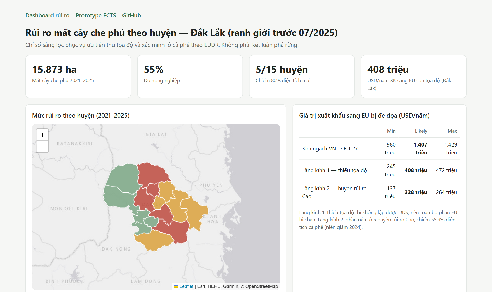
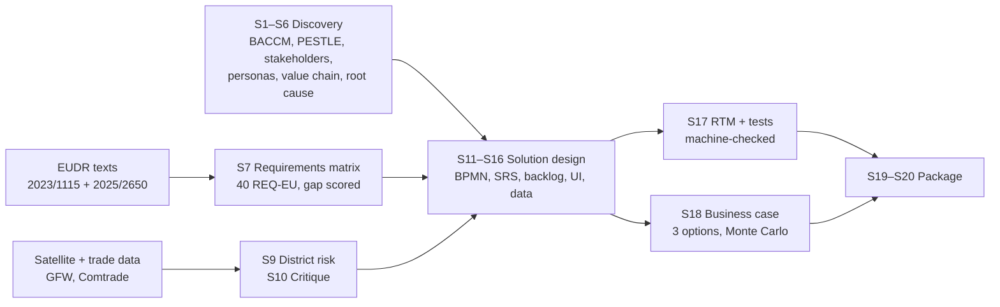
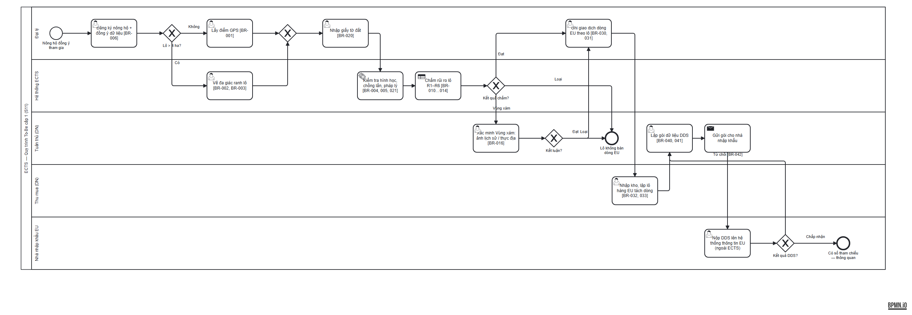
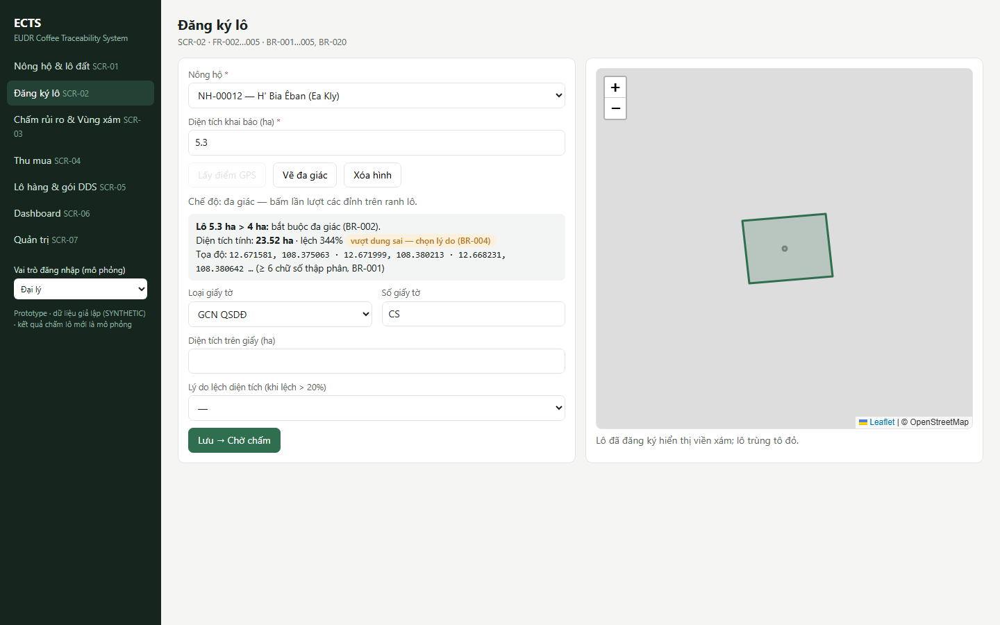
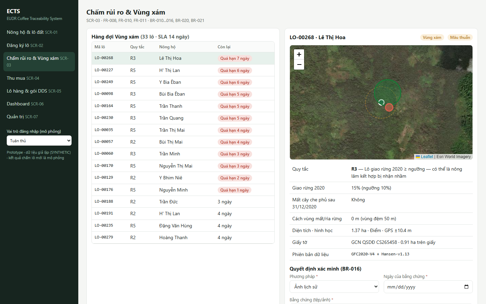
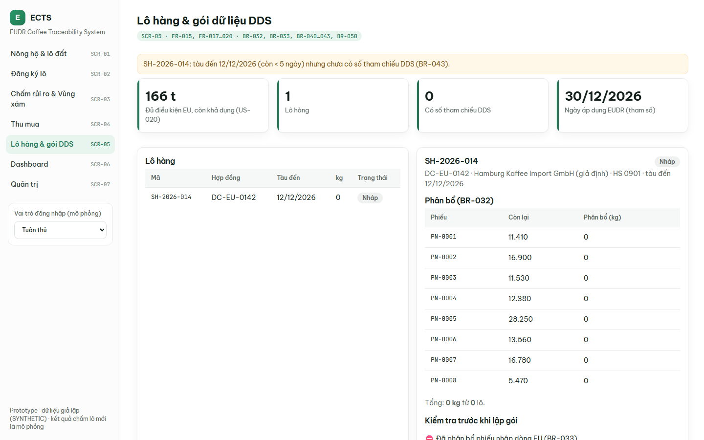
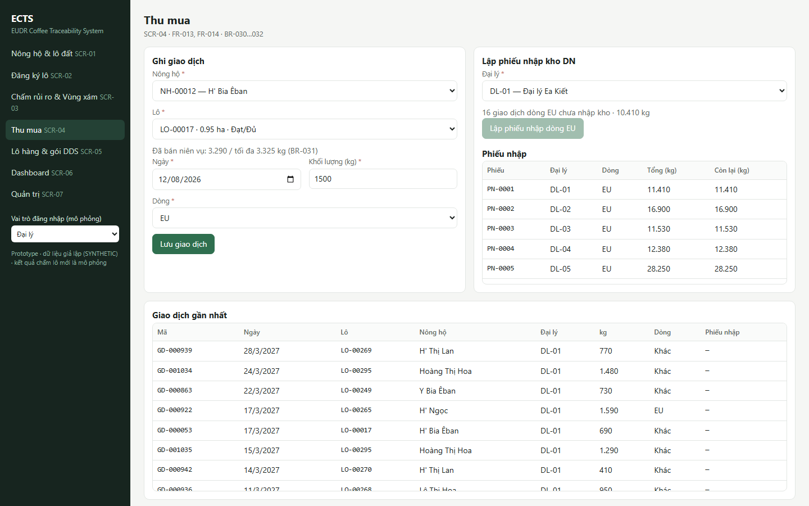

# EUDR-Ready Coffee — Deforestation-free Traceability Solution Design

**Business analysis of how a Vietnamese coffee exporter can meet the EU Deforestation Regulation (EUDR): regulation → satellite data → requirements → design → business case.**
Scope: Robusta · Đắk Lắk (pre-2025 boundaries) · fictitious mid-size exporter · October 2026.

**[Live dashboard](https://taint7684.github.io/eudr-coffee-ba/)** · **[Clickable prototype](https://taint7684.github.io/eudr-coffee-ba/prototype/)** · **[Executive summary](07-package/S19-executive-summary.md)** · **[Case study](07-package/S19-case-study.md)**

[](https://taint7684.github.io/eudr-coffee-ba/)
<sub>District risk dashboard (S9) — click to open the live version.</sub>

## Three findings

1. **Missing data is the binding constraint, not deforestation.** Without plot coordinates no due diligence statement can be filed. That puts **USD 245–472 m/year** of Đắk Lắk coffee exports to the EU at risk; USD 137–264 m sits in the five high-risk districts, which hold 55.9% of the province's coffee area (2024 statistical yearbook).
2. **Vietnam is low-risk under EUDR, but plot-level evidence is still required.** The exporter is not the EUDR *operator*, so the system produces a **DDS data package** for the EU importer.
3. **Tree cover loss ≠ deforestation.** 15,873 ha were lost in 2021–2025 (−48% vs. 2016–2020). 5 of 15 districts account for 80% of it. In core coffee districts the loss is almost entirely agricultural, likely replanting rather than forest conversion.

## Project map



## To-be process (BPMN 2.0)

[](04-solution/S11-bpmn/bpmn-to-be.md)
<sub>Plot registration → automated plot screening (rules R1–R6) → gray-zone verification → EU-stream purchase → DDS data package → importer files the DDS. Source: [ects-to-be.bpmn](04-solution/S11-bpmn/ects-to-be.bpmn).</sub>

## Prototype

<table>
<tr>
<td width="50%"><a href="https://taint7684.github.io/eudr-coffee-ba/prototype/#SCR02"></a><br><sub><b>SCR-02 Plot registration</b> — point or polygon, &gt; 4 ha forces a polygon, overlap and area checks</sub></td>
<td width="50%"><a href="https://taint7684.github.io/eudr-coffee-ba/prototype/#SCR03"></a><br><sub><b>SCR-03 Risk screening</b> — gray-zone queue with 14-day SLA, decision requires evidence</sub></td>
</tr>
<tr>
<td width="50%"><a href="https://taint7684.github.io/eudr-coffee-ba/prototype/#SCR05"></a><br><sub><b>SCR-05 Shipment &amp; DDS package</b> — EU-stream allocation, pre-checks, GeoJSON export</sub></td>
<td width="50%"><a href="https://taint7684.github.io/eudr-coffee-ba/prototype/#SCR04"></a><br><sub><b>SCR-04 Purchasing</b> — EU stream locked for non-eligible plots, yield cap warning</sub></td>
</tr>
</table>

## Business case at a glance

| | A. Build | B. Rent SaaS | C. Industry consortium |
|---|---:|---:|---:|
| 3-year NPV, likely (USD m) | 3.46 | **4.43** | 4.04 |
| Weighted score, exporter / farmer view | 2.95 / 3.15 | 3.65 / 3.15 | **4.30 / 4.50** |


<sub>The three parameters that move NPV most are all on the benefit side: price penalty avoided, EU share, volume. Recommendation: B now, C from 2027 ([S18](06-business-case/S18-business-case.md)).</sub>

## Deliverables

| Code | Deliverable | Link |
|---|---|---|
| S1 | BACCM | [01-discovery/S1-baccm.md](01-discovery/S1-baccm.md) |
| S2 | PESTLE | [01-discovery/S2-pestle.md](01-discovery/S2-pestle.md) |
| S3 | Stakeholders + Power/Interest | [01-discovery/S3-stakeholders.md](01-discovery/S3-stakeholders.md) |
| S4 | Personas | [01-discovery/S4-personas.md](01-discovery/S4-personas.md) |
| S5 | As-is value chain (goods + data) | [01-discovery/S5-asis-value-chain.md](01-discovery/S5-asis-value-chain.md) |
| S6 | Root cause (fishbone, 5 whys) | [01-discovery/S6-root-cause.md](01-discovery/S6-root-cause.md) |
| S7 | EUDR requirements matrix & gap analysis | [CSV](02-regulatory/S7-eudr-requirements.csv) · [summary](02-regulatory/S7-summary.md) |
| S8 | Data inventory | [03-data/S8-data-inventory.csv](03-data/S8-data-inventory.csv) |
| S9 | District risk analysis + dashboard | [03-data/S9-risk-analysis.md](03-data/S9-risk-analysis.md) |
| S10 | Data critique | [03-data/S10-critique.md](03-data/S10-critique.md) |
| S11 | BPMN to-be + RACI | [04-solution/S11-bpmn/](04-solution/S11-bpmn/) |
| S12 | Context, DFD, BFD, function list | [04-solution/S12-scope/](04-solution/S12-scope/) |
| S13 | SRS (ISO/IEC/IEEE 29148) | [04-solution/S13-srs.md](04-solution/S13-srs.md) |
| S14 | Story map, DoR/DoD, release plan | [04-solution/S14-backlog/](04-solution/S14-backlog/) |
| S15 | Screen spec, state, ERD, sequence, permissions | [04-solution/S15-design/](04-solution/S15-design/) |
| S16 | Synthetic data (seeded) | [04-solution/S16-synthetic-data/](04-solution/S16-synthetic-data/) |
| S17 | RTM, test design, UAT | [05-test/](05-test/) |
| S18 | Business case | [06-business-case/S18-business-case.md](06-business-case/S18-business-case.md) |
| S19 | Executive summary, case study | [07-package/](07-package/) |
| S20 | Interview defence Q&A | [07-package/S20-interview-qa.md](07-package/S20-interview-qa.md) |
| — | Sources · assumptions · decisions · risks | [00-management/](00-management/) |

## By the numbers

40 EUDR obligations · 24 FR · 28 business rules (EARS) · 12 NFR · 31 user stories · 58 acceptance criteria · 88 test cases · 184 RTM rows · 0 coverage errors · 33 sources · 32 assumptions · 9 decisions.

## Reproduce

Requires Python 3.10+, `openpyxl` and `pypdf`. Raw data are not committed; download commands are in each folder's README.

```bash
py 02-regulatory/scripts/html2txt.py && py 02-regulatory/scripts/build_s7.py     # S7 from official texts
py 03-data/scripts/00_gso_coffee.py                                               # yearbook coffee area
py 03-data/scripts/01_extract_gfw.py && py 03-data/scripts/02_comtrade_eu.py      # data
py 03-data/scripts/03_drivers.py && py 03-data/scripts/04_analysis.py && py 03-data/scripts/05_sensitivity.py
py 04-solution/S16-synthetic-data/generator.py                                    # synthetic data
py 04-solution/trace/build_rtm.py && py 04-solution/trace/build_docs.py           # RTM + SRS tables (fails on gaps)
py 06-business-case/S18_model.py                                                  # business case
py tools/build_site_data.py                                                       # dashboard + prototype data
```

## Tools

Python (data pipeline, models, RTM checks) · Google Earth Engine (plot overlay script) · Mermaid · Leaflet · GitHub Issues/Projects/Pages.

## Limitations

- Public data and labelled synthetic data only; no company data, no field interviews.
- District statistics do not replace plot boundaries; they are used for screening and prioritisation only.
- Hansen × JRC GFC2020 overlay is an extension ([script](03-data/notebooks/T8.1_hansen_vs_gfc2020.js)); plot screening already flags disagreement between the two layers as a gray zone.
- District analysis uses administrative boundaries from before 1 July 2025.

## Disclaimer

Independent research. Not legal advice. Not affiliated with any company. "DakCoffee Export" is fictitious. Synthetic data files end in `_SYNTH` and start with a `SYNTHETIC DATA` line.

## Data licences

Global Forest Watch / Hansen et al. (CC BY 4.0) · Sims et al. 2025 · JRC GFC2020 · UN Comtrade terms of use · Đắk Lắk Statistical Yearbook 2024 · geoBoundaries (CC BY 3.0 IGO) · EU legal texts (reuse permitted). GADM boundaries are used locally only and are not redistributed. Project documents are licensed CC BY 4.0, code MIT ([LICENSE](LICENSE)).
